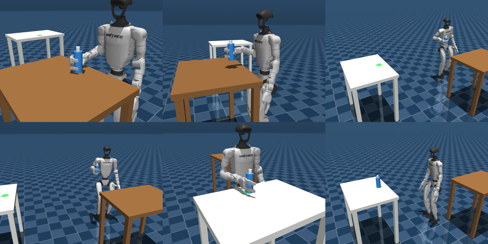

# Lesson 3: the Unitree G1 picks up a bottle

The full G1 humanoid (29 body joints + two Dex3 hands = 43 motors) walks to table A, picks up a bottle, walks to table B and puts the bottle on the green mark. It takes about 45 seconds, in real time.



## Run it

```bash
./run.sh g1-pick-place
```

- The first run installs MuJoCo and ONNX Runtime (`uv sync --extra sim`).
- A MuJoCo window opens. The terminal shows each step: `step 3/17: move the open hand next to the bottle`.
- At the end you get `done: the bottle stands 1.0 cm from the mark`. The robot keeps standing; Ctrl-C stops everything.
- To push the robot or the bottle: double-click a part, then Ctrl + right-drag.
- Backspace in the window resets only the physics, not the mission. To start over, stop and run again.

A random room with more objects on the tables (tell-the-robot phase 3): `SEED=7 ./run.sh g1-pick-place`. The robot still fetches the blue bottle; the Rerun **memory** panel lists everything it has seen.

To check it without a window: it runs about 10x faster than real time and ends with PASS or FAIL.

```bash
cd humanoid/03-g1-pick-place
uv run python tests/test_mission.py
```

## The 17 steps

walk to table A → raise the hand → move the open hand next to the bottle → move the hand around the bottle → close the hand → lift the bottle → hold it close → step back → walk to table B → move the bottle over the mark → put it down → open the hand → pull the hand away → raise the hand → hand in the carry pose → step back → arm down

## How it's built

Nine dora nodes. Each does one job, the same split as on a real robot:

| Node | Job | On the real G1 |
| --- | --- | --- |
| `sim` | physics at 500 Hz, the motor drivers, the sensors, the 3D window | the robot itself |
| `locomotion` | walks (Unitree's trained policy) or stands still and balances | Unitree's locomotion controller |
| `arm` | moves the right hand (inverse kinematics, smooth paths), opens and closes it | an arm controller (like MoveIt + ros2_control) |
| `task` | the 17 steps | a mission planner / behavior tree |
| `camera` | renders the head camera, color and depth, 15 Hz | the RealSense D435i in the G1's head |
| `perception` | finds the bottle in the images, its 3D position in the room | the same code |
| `detector` | OWLv2 finds every object on the tables while the robot stands still; kind from height, color from hue | the same code |
| `world` | the memory: every object seen, with an id that doesn't change, forgotten only when the camera should see it and doesn't | the same code |
| `dashboard` | Rerun: 3D room, camera images, charts, mission log; only listens | the same code |

The messages between them:

| From → to | Message | How often | What's in it |
| --- | --- | --- | --- |
| sim → locomotion, arm | `low_state` | 500 Hz | 43 joint angles and speeds, IMU (tilt, turn rates) |
| sim → task | `base_pose` | 50 Hz | where the robot is |
| sim → camera | `world_state` | 15 Hz | every position in the scene, to draw it |
| camera → perception | `rgb`, `depth`, `cam_pose` | 15 Hz | the images and where the camera was |
| perception → task | `bottle_pose` | 15 Hz | where the camera sees the bottle |
| locomotion → sim | `joint_command` | 50 Hz | legs + waist: target angle, kp, kd, extra torque |
| arm → sim | `joint_command` | 50 Hz | arms + hands: the same four values per joint |
| task → locomotion | `cmd_vel` | 50 Hz | walk: forward, left, turn |
| locomotion → task | `standing` | 50 Hz | 1 = standing still and steady |
| task → arm | `arm_command` | once per step | one arm move, or open/close the hand |
| arm → task | `arm_status` | when done | which command finished |

The robot logic lives in `g1/`, plain Python classes without dora. The nodes only pass messages to and from them. Why:

- **Testable:** `tests/test_mission.py` runs the same classes in one loop, without dora.
- **Reusable:** the classes don't care where messages come from (dora today, ROS 2 or the real robot tomorrow).
- **Readable:** each file has one job.

## How each part works

### Motor commands

The same command the real G1 takes (Unitree's `LowCmd`): for each joint a target angle, a stiffness kp, a damping kd and an extra torque. The motor driver turns them into torque 500 times a second:

`torque = kp × (target − angle) − kd × speed + extra torque`

That is lesson 1's controller, now for 43 joints. In the simulation, `g1/simulator.py` plays the motor drivers.

### Walking: Unitree's trained policy

The legs walk with Unitree's own controller, a small neural network they trained with reinforcement learning (see `policies/README.md`). Every 20 ms it gets 47 numbers (tilt, turn rates, wanted velocity, leg angles and speeds…) and returns 12 leg target angles. We run it exactly as Unitree's config says: same inputs, same gains (hips 100, knees 150, ankles 40), same 50 Hz.

It was trained on a G1 with fixed arms and light hands. Two differences mattered, and we fixed both:

- **Arm pose.** The Dex3 hands add 2.3 kg. That moves the center of mass 1.3 cm forward, and the robot crept forward at 0.2 m/s when told to stand still. With the elbows at 1.2 rad, the center of mass is back where it was in training, 4.6 cm in front of the ankles. Drift now: 0.03 m/s.
- **Waist.** Training had a rigid waist. With Unitree's real-robot waist gain (kp 300) and kd 6, the torso stops twisting at every step. The slow turning drift dropped from 0.08 to 0.02 rad/s.

Measured: asked 0.5 m/s forward, it walks 0.50 m/s; asked 0.5 rad/s turning, it turns 0.47.

### Standing still: balance

The policy never stands still; it keeps stepping in place. For the arm to work, the robot has to stop. After 0.8 s at zero speed, at a moment when both feet are on the ground, the legs blend in 1 s into a fixed standing pose:

- **Pose:** knees bent 0.4 rad. That puts the center of mass over the middle of the foot (2 cm in front of the ankle; the foot reaches from 5 cm behind to 12 cm in front).
- **Stiff ankles:** a standing robot is an upside-down pendulum. Leaning pulls it over with 34 kg × 9.81 m/s² × 0.65 m = 220 Nm per radian. Two ankles at 250 Nm/rad each give 500 Nm/rad, more than 220, so it stays up.
- **Ankle strategy** (what people do): leaning forward, push down with the toes; leaning back, lift them. Ankle target += 0.5 × lean + 0.1 × lean speed (from the IMU).

### Walking to a spot: navigation

`speed = 0.8 × distance still to go`, at most 0.4 m/s, and the same idea for turning. Far away it walks at full speed, close by it slows down, and within 4 cm and 3.4° it stops. Two additions that real robots use too:

- **Smoothing:** the speed may change by at most 0.5 m/s per second, so the policy can follow.
- **Minimum speed:** at least 0.08 m/s (and 0.15 rad/s turning) near the goal. The policy ignores smaller commands.

### The arm: inverse kinematics, smooth moves, gravity

- **Inverse kinematics** (`g1/arm_ik.py`): "the hand should be here" → 7 joint angles. There's no formula for it, so the code searches: MuJoCo's Jacobian says how the hand moves when each joint turns a little, and each step turns the joints to shrink the error (damped least squares). It stops at 1 mm.
- **Two kinds of moves,** like industrial arms (Universal Robots calls them movej and movel). A *joint move* turns every joint straight to its new angle; it's for big moves through free space. A *line move* takes the hand in a straight line; it's for moves near the bottle and the tables.
- **Speed profile:** speed up, cruise, slow down, stop on the target, as in lesson 1. Hand moves: 0.15 m/s, 0.3 m/s². Joint moves: 1 rad/s, 2 rad/s².
- **Gravity compensation:** MuJoCo computes the torque each arm joint needs to hold the arm's weight, and the arm node sends it as extra torque. It's lesson 1's weight torque, for all 28 arm and hand joints.
- **Where it can reach:** we tried hundreds of hand targets with the IK. The right hand grasps best 0.85–0.95 m high and 22–38 cm in front. That's why the tables are 0.80 m high and the robot stands with the bottle 30 cm ahead and 12 cm to its right.

### The grasp

The Dex3 hand has a thumb (3 joints) and two fingers (2 joints each). The palm faces left and the fingers point forward. The open hand stops 8 cm to the right of the bottle, then moves left until the palm touches it. Then the fingers and thumb curl around it. Their targets lie past the bottle, so the motors keep squeezing, and friction holds the 0.35 kg bottle.

### The mission

`g1/mission.py` is a list of 17 steps, done one after another. Each step computes its target **when it starts**, from what the robot sees at that moment. If the robot stops 3 cm off, the hand target moves 3 cm too, so errors don't add up. To put the bottle down, the hand lowers until the bottle's bottom is 5 mm above the table (from the bottle's measured height), opens, and slides away sideways.

## Files

```
03-g1-pick-place/
├── dataflow.yml              the dora graph: 9 nodes and their messages
├── nodes/                    the dora nodes: messages in -> g1 class -> messages out
│   ├── sim.py                physics, motor drivers, sensors, 3D window
│   ├── locomotion.py         walking / standing
│   ├── arm.py                arm moves and grip
│   ├── task.py               the mission
│   ├── camera.py             head camera images
│   ├── perception.py         the bottle from the images
│   ├── detector.py           objects on the tables, 1.5 Hz while standing
│   ├── world.py              the memory of objects
│   └── dashboard.py          Rerun view
├── g1/                       the robot software (plain Python, no dora)
│   ├── robot.py              joint names and groups, poses, gains
│   ├── messages.py           the layout of every message
│   ├── simulator.py          MuJoCo world, motor drivers, sensors
│   ├── locomotion.py         walking policy and standing balance
│   ├── navigation.py         go to a spot -> walking velocity
│   ├── arm_ik.py             inverse kinematics
│   ├── arm.py                arm moves, gravity compensation, grip
│   ├── mission.py            the 17 steps
│   ├── camera.py             head camera: render, intrinsics, pose
│   ├── perception.py         color mask, back-projection, cylinder fit
│   ├── frames.py             room frame <-> robot frame, tilt
│   ├── detector.py           OWLv2: where objects are
│   ├── objects.py            box -> kind, color, position; merge duplicates
│   ├── world.py              the memory: matching, ids, careful forgetting
│   ├── survey.py             look around: two spots, three views
│   └── scenes.py             random rooms (SEED=7 ./run.sh g1-pick-place)
├── robot/                    the G1 (MuJoCo Menagerie) and the room, see robot/README.md
├── policies/                 Unitree's walking policy, see policies/README.md
├── tests/test_mission.py     the whole mission without dora or window: PASS or FAIL (--vision: from the camera)
├── tests/test_camera.py      a known 3D point lands on the right pixel
├── tests/test_world.py       the memory's rules, without a simulator
└── tools/export_walk_policy.py   rebuilds policies/g1_walk.onnx
```

## What a real robot does differently

- **Where things are:** the bottle's position comes from the head camera (color, depth, a cylinder fit). The robot's own position still comes straight from the simulator; a real G1 needs localization (lidar + map).
- **Obstacles:** there's no obstacle avoidance; the room is laid out so straight paths are free. A real robot uses a path planner (for example ROS 2 Nav2).
- **Falls:** if you push it over, it doesn't get up.

## Try

- Move the bottle on table A in `robot/scene.xml`, for example `pos="1.42 0.12 0.875"`. The robot stands somewhere else and still gets it.
- Move the mark: change `PLACE_POINT` in `dataflow.yml` and the green `place_target` in `robot/scene.xml`.
- Push the robot while it walks, and watch the policy catch itself.
- After any change: `uv run python tests/test_mission.py`.
