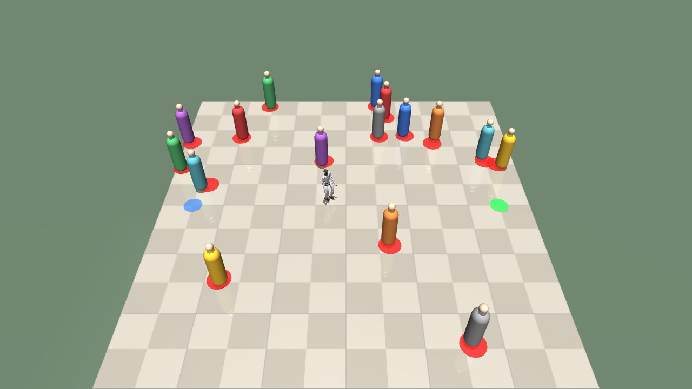
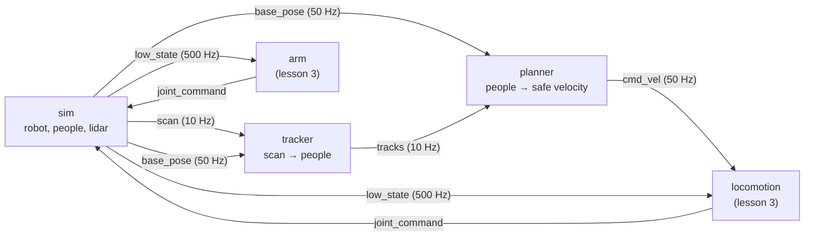

# The Unitree G1 crosses a busy square

16 people walk across a 12 m × 12 m square, each in their own direction. The G1 humanoid has to walk from the west side to the green mark on the east side, 10 m away, without bumping into anyone.



The robot does not get told where the people are. It has a **lidar** (a laser scanner) on its head, like the real G1, and must work everything out from that. The red rings show where the robot *thinks* people are.

This lesson reuses the robot from `../03-g1-pick-place` (the G1 model, the walking network, the motor code) without copying it. Read that lesson's README for how the robot walks.

## Run it

From the top folder of the repository:

```bash
./run.sh g1-crowd
```

A window opens. The terminal prints how far the robot still has to go every 5 seconds, then `arrived at the goal` (after 25 to 50 s, depending on the crowd). Press Ctrl-C to stop.

To try another crowd, change `SEED: 0` in `dataflow.yml` to another number. To make it harder, raise `PEOPLE: 16`.

Check it without a window (5 different crowds in about 9 seconds):

```bash
cd humanoid/04-g1-crowd
uv run python tests/test_crossing.py
```

## The big picture

Five programs (dora nodes). Two are new, two are lesson 3's programs **used as they are**, and `sim` is a new version for this world.



This is the classic robot pipeline: **sense → understand → decide → move**.

| Node | Job | On a real G1 |
|---|---|---|
| `sim` | physics, the people, the lidar, the window | the robot and the real world |
| `tracker` | finds people in each lidar scan and follows them | a people tracker |
| `planner` | picks a walking velocity that is safe and gets nearer to the goal | a local planner (like in ROS 2 Nav2) |
| `locomotion` | turns the velocity into leg motion | Unitree's walking controller |
| `arm` | holds the arms in the walking pose | an arm controller |

## Where everything lives

```
humanoid/04-g1-crowd/
├── dataflow.yml          which programs run and how they are wired
├── nodes/                the 3 new dora programs (they only pass messages)
│   ├── sim.py
│   ├── tracker.py
│   └── planner.py
├── crowd/                the logic: plain Python, knows nothing about dora
│   ├── pedestrians.py    how the people walk (social force model)
│   ├── world.py          the square in MuJoCo: robot + people + lidar
│   ├── tracker.py        lidar scans → people and their velocities
│   ├── planner.py        people → a safe walking velocity
│   └── messages.py       the layout of the two new messages
├── world/square.xml      the square (the robot is included from lesson 3)
├── tests/test_crossing.py   the whole crossing without dora: PASS or FAIL
├── tools/make_picture.py    draws media/square.jpg
└── media/
```

## 1. The people (`crowd/pedestrians.py`)

The people follow the **social force model** (Helbing and Molnár, 1995), the standard model for simulated crowds. Each person feels pushes, like forces:

```
acceleration = (wanted velocity − velocity) ÷ 0.5 s      toward their goal
             + a push away from every other person        around people
             + a push away from the robot                 around the robot
```

The push away from another body gets stronger the closer it is:

```
push = 12 × e^(−gap ÷ 0.3)   m/s²        gap = free space between the two bodies
```

At 1 m of free space that is 12 × e^(−1/0.3) = 0.43 m/s², a gentle drift aside. At touching distance it is 12 m/s², a quick step aside.

| Name | Value | Where it comes from |
|---|---|---|
| `MEAN_SPEED`, `SPEED_SPREAD` | 1.34 m/s, ± 0.26 | measured walking speeds of real people (Helbing and Molnár 1995) |
| `RELAX_TIME` | 0.5 s | how fast people get back to their own speed (same paper) |
| `RADIUS` | 0.22 m | a person from above: about 44 cm shoulder to shoulder |
| `PUSH`, `PUSH_RANGE` | 12 m/s², 0.3 m | found by testing 16 people for 90 s: nobody ever touches anybody, and people still average 1.1 m/s |
| `BEHIND_WEIGHT` | 0.3 | people react mostly to what is in front of them |
| `SIDESTEP` | 0.6 | part of the push is turned to the right, so two people walking at each other pass instead of only braking |
| `ROBOT_WEIGHT`, `ROBOT_SPACE` | 1.0, 0.40 m | people step around the robot like around a person, and give it a bit more room than its real 0.30 m |

Each person walks to a random point on another side of the square. When they get there, they pick the next one. So the crowd never runs out.

**An honest note.** With people who avoided the robot only half as much (`ROBOT_WEIGHT` 0.5), the robot was touched in about 1 of 10 crossings. The robot walks 0.6 m/s and people 1.3 m/s, so it can't get out of everyone's way alone. Real robots in crowds also depend on people cooperating.

## 2. The world and the lidar (`crowd/world.py`)

`CrowdWorld` is lesson 3's `Simulator` plus people and a lidar.

- **People in MuJoCo.** Each person is a solid figure 1.7 m tall, added by code so the number is a setting. They are "mocap" bodies: our code moves them, and physics can't push them. If one walks into the robot, the robot gets shoved. The test checks that this never happens.
- **The lidar** shoots 360 laser rays, one per degree, in a flat circle around the robot's head, 10 times per second. Each ray returns the distance to the first thing it hits, or infinity if there is nothing within 12 m. MuJoCo computes this with `mj_multiRay`.

| Name | Value | Why |
|---|---|---|
| `LIDAR_RAYS` | 360 | one per degree, typical for a small 2D lidar (for example RPLIDAR A2) |
| `LIDAR_RATE` | 10 turns per second | the same class of lidar |
| `LIDAR_RANGE` | 12 m | the same |
| `LIDAR_NOISE` | 1 cm | real distances are never exact; each one is off by about 1 cm |
| `LIDAR_MOUNT` | 0.50 m above the torso's origin | on top of the head, so the rays pass over the robot's own arms |

## 3. Finding and following people (`crowd/tracker.py`)

A scan is just 360 distances. Three steps turn it into people:

1. **Cluster.** Turn each distance into a point on the ground. Points next to each other and less than 25 cm apart belong to the same thing.
2. **Detect.** A cluster up to 80 cm wide with at least 2 points is a person. The lidar only sees the near side of a body, so the middle of the points lies in front of the person's true center, by 2R/π = 0.64 × 0.22 m = 14 cm for a round body. The code pushes the detection back by that much.
3. **Track.** Match each known person to the nearest new detection (within 0.6 m). Then update with an **alpha-beta filter**, the simplest tracking filter:

```
predicted position = old position + velocity × 0.1 s
error              = measured position − predicted position
position           = predicted position + 0.6 × error
velocity           = velocity + 0.3 × error ÷ 0.1 s
```

So the velocity comes from how each person moved between scans. A person must be seen in 3 scans (0.3 s) to count, and is forgotten after 8 missed scans (0.8 s), for example when hidden behind someone.

**How good is it?** Measured against the true positions over 20 s: about 15 of 16 people tracked at any moment, position error about 3 cm, velocity error about 0.13 m/s.

## 4. Choosing where to walk (`crowd/planner.py`)

The idea is "try many, keep the best" (the idea of the Dynamic Window Approach, a standard local planner). 10 times per second:

1. **List what the robot could do:** 13 directions (every 15°, up to 90° either side of the straight line to the goal) × 2 speeds (0.6 and 0.3 m/s), plus standing still. That is 27 options.
2. **Look 4 seconds ahead** for each option, in steps of 0.2 s. The robot gets to that velocity at 0.5 m/s² (it can't change at once). Every person keeps walking as they do now.
3. **Give each option a cost**, counted in meters:
   - **progress:** how much nearer to the goal it gets (nearer = lower cost),
   - **people:** coming closer than 0.8 m of free space to someone costs up to 4; overlapping costs up to 60 more. Far-future moments count less, because they are less certain,
   - **steadiness:** 0.5 per radian of direction change, so it doesn't zigzag.
4. **Take the cheapest option.**

`to_cmd_vel` then turns the chosen velocity into (forward, sideways, turn) for the legs. The robot turns to face the way it walks, like a person.

The robot never walks away from the goal. People are twice as fast, so running away doesn't help; an earlier version that could do it wandered around the square for 90 s. When no direction is good, it slows down or stands still and lets people pass.

| Name | Value | Why |
|---|---|---|
| `MAX_SPEED` | 0.6 m/s | the walking network was trained up to 1 m/s; 0.6 is steady |
| `HORIZON`, `LOOK_DT` | 4 s, 0.2 s | a person 5 m away arrives in about 4 s |
| `ROBOT_RADIUS`, `PERSON_RADIUS` | 0.30 m, 0.22 m | sizes from above; centers closer than 0.52 m = a bump |
| `COMFORT` | 0.8 m | free space the robot likes to keep |
| `GROWTH` | 0.05 m per second | people change their minds, so each looked-ahead second makes them 5 cm bigger |
| `ARRIVED` | 0.3 m | the radius of the green mark |

## How we know it works

`tests/test_crossing.py` runs the same classes in one loop, without dora, about 18 times faster than real time. A crossing passes if the robot **arrives** within 90 s, **never touches** a person (no contact in the physics) and **doesn't fall**.

Results over 40 different crowds (seeds 0 to 39):

| | With the planner | Robot ignores people (walks straight) |
|---|---|---|
| arrived | 40 of 40 | 40 of 40 |
| touched a person | 0 | 1 |
| time to cross | 30 s on average, 48 s at most | 21 s |
| closest free space to a person, typical | 31 cm | 19 cm |
| closest free space, worst crossing | 12 cm | −1 cm (an overlap) |

Read this honestly: the people do a lot of the avoiding themselves. The planner buys more distance and no touches, and pays with 9 seconds.

The live dora run (`./run.sh g1-crowd`) runs at about 100% of real time; with crowd 0 the robot arrives after about 25 s.

## What a real robot does differently

- **Where am I?** `base_pose` comes straight from the simulator. A real robot needs localization.
- **Only people.** The square is empty except for people. Walls, benches and static obstacles need a map and a global planner as well.
- **Real people** are less predictable than this model: they stop, turn around, walk in groups, look at their phones.
- **A flat lidar scan** sees a person as one blob. Real robots use 3D lidar or cameras and can see which way a person faces.
- **Smarter planners** exist: ORCA and social-navigation planners model that people react to the robot.

## Sources

- Dirk Helbing and Péter Molnár, *Social force model for pedestrian dynamics*, Physical Review E, 1995: the people.
- Dieter Fox, Wolfram Burgard and Sebastian Thrun, *The Dynamic Window Approach to Collision Avoidance*, 1997: the planner's idea.
- The robot model, walking network and their licenses: see `../03-g1-pick-place/README.md`, section 22.
